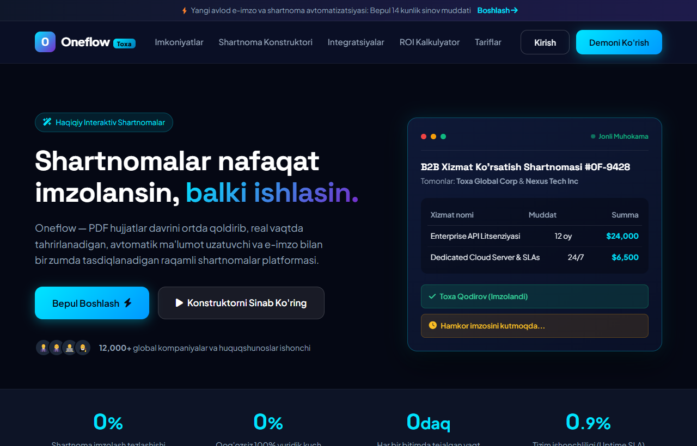

# Oneflow (Toxa) — Raqamli Shartnomalar va e-Imzo Avtomatlashtirish Platformasi

Oneflow — zamonaviy korporativ bizneslar, yuristlar va savdo jamoalari uchun statik PDF formatidan to'liq voz kechib, real vaqtda tahrirlanadigan, avtomatik ma'lumot almashuvchi va yuridik jihatdan 100% himoyalangan raqamli shartnomalar tuzish platformasining mukammal foydalanuvchi interfeysi (UI).

---

## 📸 Veb-Sahifa Ko'rinishi (Skrinshot)



---

## 🌟 Asosiy Imkoniyatlar va Funksiyalar

1. **Interaktiv Shartnoma Konstruktori (Contract Builder)**:
   - Kompaniya nomi, shartnoma qiymati va to'lov turlarini real vaqtda kiritish.
   - 256-bitli SHA elektron imzo simulyatori va tasdiq muhri.
   - Jonli qoralama (Draft) va imzolangan (Signed) holatlarni avtomatik o'zgartirish.

2. **Dinamik ROI va Tejamkorlik Kalkulyatori**:
   - Kompaniyadagi oylik shartnomalar va menejerlar sonini slaydlar orqali tanlash.
   - Yillik tejaladigan ish soatlari va moliyaviy mablag'larni avtomatik hisoblash.

3. **Zamonaviy Texnologik Dizayn Tizimi**:
   - Skandinaviya minimalizmi va qorong'u rejim (Dark Mode Glassmorphism) uyg'unligi.
   - Jonli statistika taymerlari (Counter animation).
   - Mobil, planshet va katta ekranlarga to'liq moslashuvchan (Responsive).

---

## 🛠 Texnologiyalar Steki

- **HTML5**: Semantik teglash, foydalanish qulayligi (Accessibility) va SEO optimallashuvi.
- **Vanilla CSS3**: Maxsus CSS o'zgaruvchilari (Tokens), Flexbox & Grid, Glassmorphism effektlari.
- **JavaScript (ES6+)**: Reaktiv hodisalar, kalkulyator logikasi, modal va xabarnomalar.
- **Shriftlar**: Google Fonts (*Plus Jakarta Sans* & *Space Grotesk*).
- **Ikonkalar**: Font Awesome 6 Pro / Free SVG to'plami.

---

## 🚀 O'rnatish va Ishga Tushirish

Loyihani kompyuteringizda ochish juda oddiy, hech qanday qo'shimcha kutubxonalar talab etilmaydi:

1. Ushbu omborni klonlang:
   ```bash
   git clone https://github.com/qodirovtoirbektts-jpg/toxa-oneflow.git
   ```
2. Loyiha papkasiga kiring:
   ```bash
   cd toxa-oneflow
   ```
3. `index.html` faylini ixtiyoriy brauzerda oching.

---

## 🔗 Foydali Havolalar

- **GitHub Repozitoriyasi**: [https://github.com/qodirovtoirbektts-jpg/toxa-oneflow](https://github.com/qodirovtoirbektts-jpg/toxa-oneflow)
- **Jonli Veb-Sahifa (GitHub Pages)**: [https://qodirovtoirbektts-jpg.github.io/toxa-oneflow/](https://qodirovtoirbektts-jpg.github.io/toxa-oneflow/)

---

## 👤 Muallif

- **Muallif**: Toxa ([qodirovtoirbektts-jpg](https://github.com/qodirovtoirbektts-jpg))
